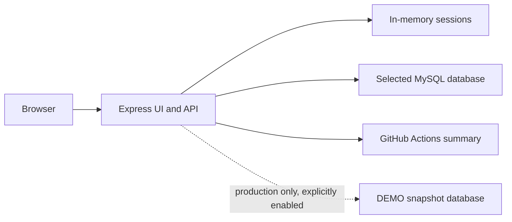

# Architecture

Reviewed 2026-10-31 against source baseline `7fc0fa9`.

CareerOps is a Node.js ES-module application for contact tracking, weekly reports,
and application/CI visibility. Express serves the browser files and JSON API from
one process; there is no frontend build step.

| Component | Current implementation |
| --- | --- |
| Browser | `ui/index.html`, `ui/login.html`, `src/app.js`, and `src/App.css` |
| HTTP/API | Express 5 in `src/server.js` |
| Persistence | MySQL through `mysql2`; eight baseline tables |
| Authentication | bcrypt passwords and `express-session` cookies |
| Runtime isolation | `src/environment.js`, `src/devGrantValidation.js`, `src/adminAccess.js` |
| DEV provisioning | `scripts/dev-bootstrap.js` and `scripts/dev-create-user.js` |
| Validation | Vitest, Playwright, and isolated MySQL SQL regression |
| Delivery | GitHub Actions validation; Railway deployment configured outside the workflow |

React-style files under `src/components/` are not the current HTML entry point.
Cypress is not the configured test runner.

## Environment and access boundaries

| Branch | Runtime | Database |
| --- | --- | --- |
| `develop` | `dev` | `careerops_dev` |
| `qa` | `qa` | `careerops_qa` |
| `demo` | `demo` | `careerops_demo` |
| `main` | `production` | `railway` |

Branches do not select runtime bindings. `APP_ENV` is explicit, connected schema
identity is verified before traffic, and test mode prohibits database connections.
DEV accepts only literal loopback hosts and restricted schema DML grants. DEV
login uses the stored `admin`, `user`, or `guest` role; deployed modes retain the
existing owner-email admin assignment. See [isolation](environment-isolation.md).

DEMO supplies guest access on authenticated routes and restricts business writes.
Telemetry endpoints can still record activity; read-only business access does not
mean the entire environment performs no writes. Production-to-DEMO synchronization
is implemented but requires explicit production-only enablement and separate
bindings. It is unavailable in DEV and QA.

Sessions use the default in-memory store. Restart invalidates sessions; replicas
would need a shared store. Production cookies are Secure/HttpOnly and the server
trusts one immediate proxy hop, assuming Railway edge-only ingress.

## Delivery and evidence

Work proceeds DEV → QA → DEMO → PROD. Validate the same candidate at each stage;
CI success is not a substitute for deployed identity and functional checks.
[Testing](testing.md) describes exact gate selections and known exclusions.
[Deployment](deployment.md) describes promotion and rollback.

The baseline passed independent local ON/OFF MySQL validation and two-clean-clone
reproducibility. The owner supplied successful Railway deployment and PROD gate
screenshots for `7fc0fa9`. This does not independently establish deployed schema
parity or every live user workflow; see [run history](run-history.md).
